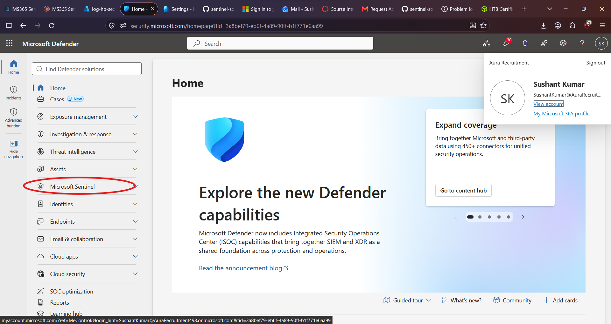

# Phase 1: Defender Portal Connection and Sentinel Roles

Sentinel SOC Build · Aura Recruitment · Phase 1 (Foundation)

## Purpose

Microsoft is moving Sentinel into the Microsoft Defender portal, which is where most day-to-day SOC work now happens. This step confirms the Sentinel workspace is connected to the Defender portal and gives each type of user only the access their job requires. Least privilege is the standard way security teams limit the damage from a compromised or mistaken account.

## 1. Confirm the Defender portal connection

New Sentinel customers who hold subscription Owner or User Access Administrator are usually onboarded to the Defender portal automatically, so the connection may already exist.

1. Open **security.microsoft.com** with the admin account.
2. Look for **Microsoft Sentinel** in the left navigation. If it is there, the workspace is connected.
3. If it is missing, go to **System > Settings > Microsoft Sentinel > Connect a workspace**, choose `log-hp-sec-prod-eus-001`, and complete the connection.

Onboarding requires at least the Security Administrator role in Microsoft Entra ID. A side benefit is that the Microsoft Defender XDR connector is enabled automatically when the workspace is onboarded, so one data source is already handled.

## 2. Roles and what they are for

| Role | Real-world use |
| --- | --- |
| Microsoft Sentinel Reader | Managers and auditors who view incidents and dashboards |
| Microsoft Sentinel Responder | Tier 1 analysts who triage and work incidents |
| Microsoft Sentinel Contributor | Engineers and Tier 2 analysts who build rules, workbooks, and playbooks |

## 3. Assign the roles

1. Open the resource group `rg-hp-sec-prod-eus-001`.
2. Go to **Access control (IAM) > Add > Add role assignment**.
3. Search for the role by name, click **Next**, choose **Select members**, pick a test user, and click **Review + assign**.
4. Repeat for each role.

If the tenant does not yet have separate test users, create them in **Microsoft Entra ID > Users** with names such as `analyst-t1`, `analyst-t2`, and `soc-manager`. Assigning roles at the resource group level keeps the setup simple and covers every resource inside it.

## 4. Documentation and evidence

Create `01-foundation/access-model.md` with a table of each user, their role, the scope, and the reason for the access. Add a screenshot of the role assignments to `01-foundation/`, with user names, tenant domain, and subscription ID blurred.

## Completion criteria

- Microsoft Sentinel appears in the Defender portal navigation.
- Reader, Responder, and Contributor roles are each assigned to a separate test user.
- `access-model.md` and a redacted screenshot are committed to the repo.
- The Defender portal and roles tasks are ticked on the tracker.

## Next step

Connect the data sources: Microsoft Entra ID, Microsoft 365, Defender XDR, and Azure Activity. These depend on the live Microsoft 365 trial tenant, so they take priority over documentation polish while the trial is active.

